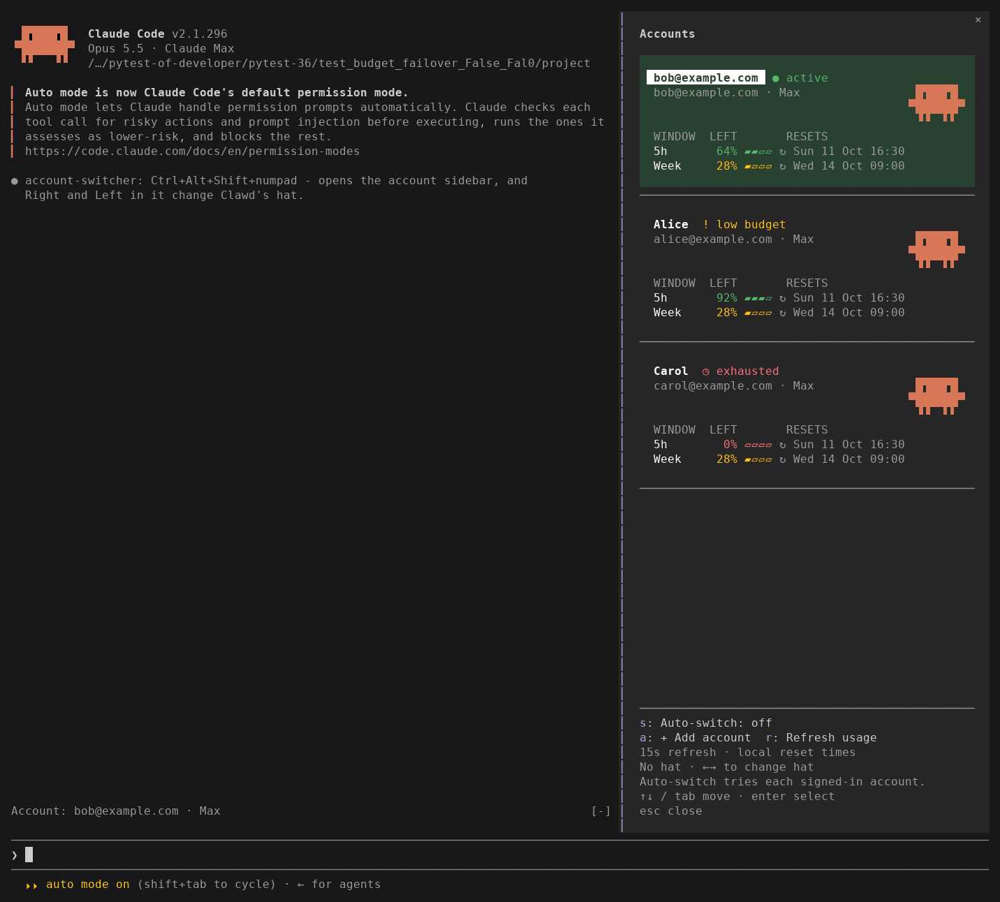
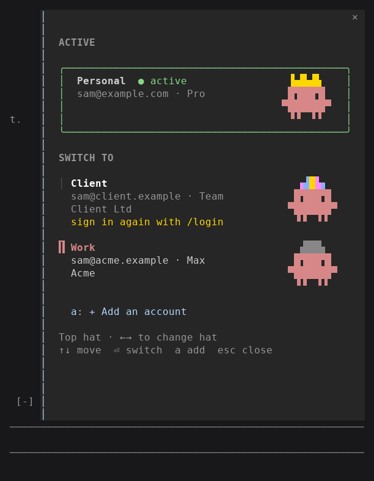
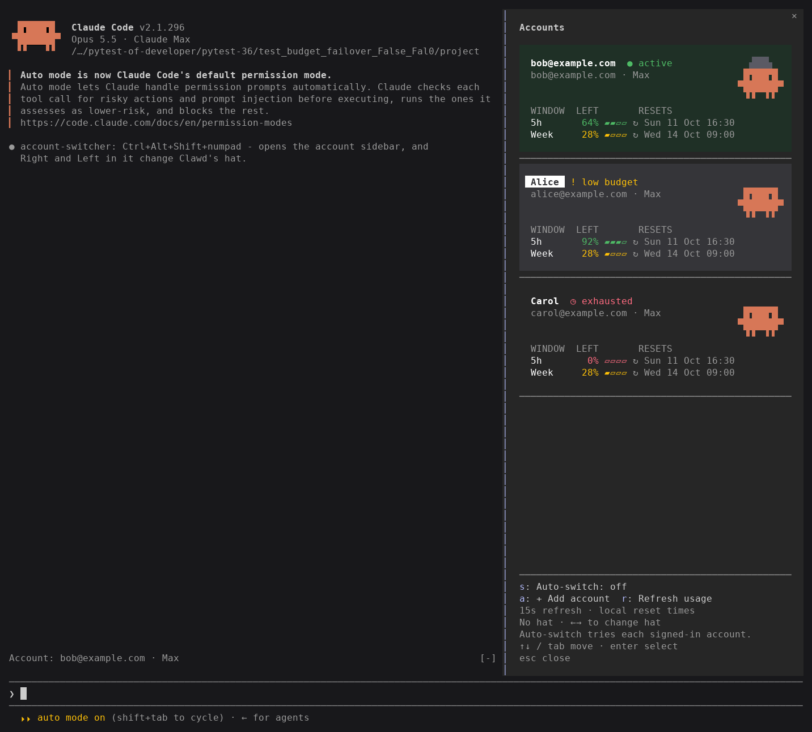
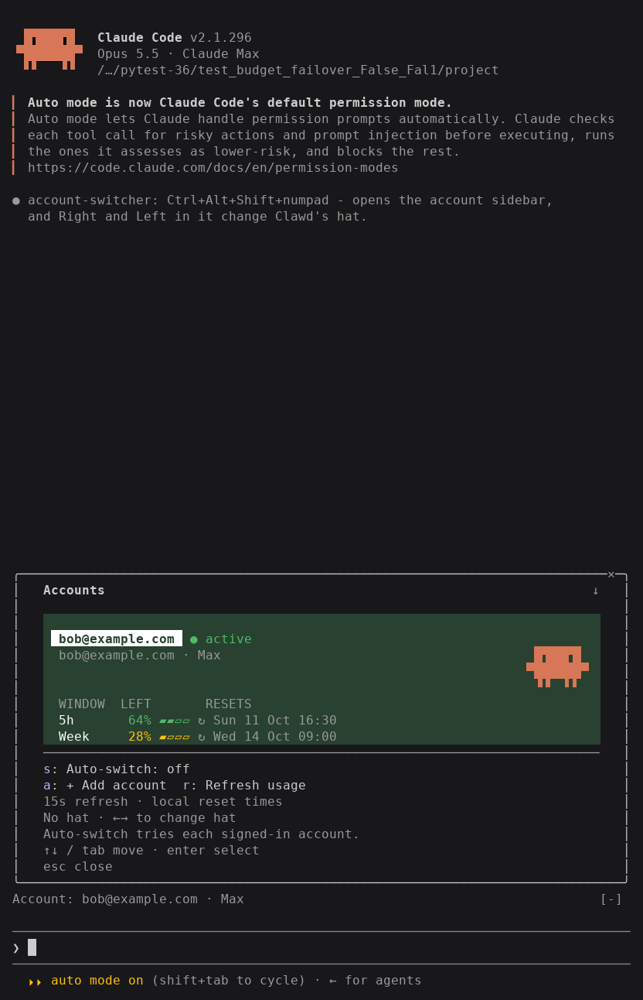
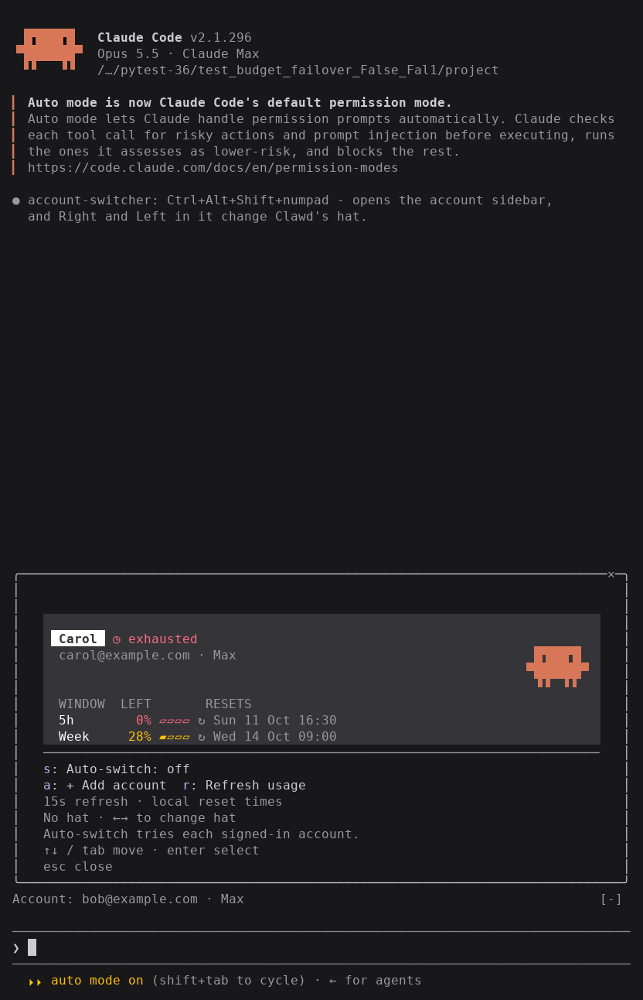
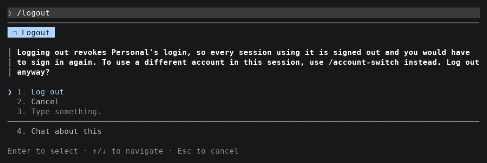

# Account switcher

A Claude Code mod for people with more than one Claude subscription. Each session can run on a different account, and you can switch a session live without logging out. Two terminals open side by side can be on your work and personal accounts at the same time.



It needs Claude Code 2.1.287 or later, the first release that loads mods. It has been tested on Linux with 2.1.296. The macOS and Windows code paths have unit tests but have not been run on either system.

## Quick start

Install it, start Claude Code, and run `/login` once for each account you want to use. After that, press Ctrl+Alt+Shift+numpad minus or run `/account-switch` to open the sidebar.

The one-liners below install from GitHub. From a clone, run `./install.sh` or `.\install.ps1` in the repository folder instead.

### Linux

```sh
curl -fsSL https://github.com/sam-ruff/account-switcher-claude-code-mod/raw/main/install.sh | sh -s -- https://github.com/sam-ruff/account-switcher-claude-code-mod.git
```

### macOS

```sh
curl -fsSL https://github.com/sam-ruff/account-switcher-claude-code-mod/raw/main/install.sh | sh -s -- https://github.com/sam-ruff/account-switcher-claude-code-mod.git
```

### Windows

In PowerShell:

```powershell
& ([scriptblock]::Create((irm https://github.com/sam-ruff/account-switcher-claude-code-mod/raw/main/install.ps1))) -Source https://github.com/sam-ruff/account-switcher-claude-code-mod.git
```

Each script checks your Claude Code version, adds this repository as a plugin marketplace and installs the mod. To remove it, run the same script with `--uninstall` (`-Uninstall` on Windows).

## Using it

`/login` signs in to an account and saves it. A new login never replaces the one other sessions are using: the mod files it as an account of its own, and the session you ran `/login` in switches to it.

Open the sidebar with Ctrl+Alt+Shift+numpad minus, with `/account-switch`, or by clicking the "Account:" line above the prompt.

| Key | In the sidebar |
| :- | :- |
| Tab, Shift+Tab | Move between accounts and controls |
| Up, Down | Move between accounts and controls, keeping the selection visible |
| Enter | Switch this session to the selected account |
| Right, Left | Change the hat Clawd wears for that account |
| a | Add an account (runs `/login`) |
| s | Toggle auto-switch |
| r | Refresh usage |
| Esc | Close |



The green account row is the one this session uses. Every other session keeps its own. Keyboard focus adds a light background tint and a padded name highlight; moving focus does not switch accounts until you press Enter. Clawd and his hat sit beside the account name, with matching space above and below each row. There are 13 hats to choose from, and each account remembers its own.

The compact ledger shows each account's remaining five-hour and weekly usage, with reset icons and local dates and times. Opening the panel reads usage using each account's own login, without switching the session. Usage refreshes every 15 seconds while the panel is open; closing it stops polling. Press `r` to request an immediate refresh. Missing or stale readings show as unknown. If the server rate-limits a refresh, automatic and manual refreshes both wait for its retry delay, with a minimum wait of 15 seconds. Expired logins need a switch to that account to refresh. Model-specific limits and extra usage are not included.

Accounts scroll inside the panel, separated by dividers. Use Up and Down or Tab to move focus; the selected account scrolls into view. The mouse wheel scrolls the account list. Controls and hints stay in a fixed footer. Names, emails and usage share the same left alignment. In narrow terminals the panel opens inline, and reset times stack below percentages when space is tight.

<details>
<summary>Keyboard focus and narrow terminal screenshots</summary>

Alice has keyboard focus below, while Bob remains active in green. The original Clawd artwork keeps its proportions, including when wearing a hat.



In an 80-column terminal, scrolling from Bob to Carol leaves the controls and hints in place.





</details>

The screenshots use fictional accounts and fixed usage readings from the integration test's local API.

The same things work as commands, which is handy in `claude -p` where there is no sidebar:

```text
/account-switch work                 switch by label, email, or the start of either
/account-switch 2                    switch by position in the list
/account-switch list
/account-switch rename sam@acme.example Work
/account-switch hat work crown
/account-switch forget client
/account-switch auto on              enable automatic budget failover
/account-switch auto off             disable it
```

Auto-switch is off by default. Enable it in the sidebar or with `/account-switch auto on`; the mod remembers the setting. When an account hits a usage or billing limit, the session switches to the next signed-in account in list order, wrapping to the top, and sends a continuation prompt. Each account is tried once before stopping. Accounts needing `/login` are skipped. A new prompt from you, a manual switch, or toggling the setting starts a fresh attempt. Other sessions keep their own account.

Temporary server limits, other API errors, interrupted turns and subagent failures do not trigger auto-switch.

Don't use `/logout` to change accounts. Claude Code revokes the login on Anthropic's side when you log out, so every session using that account is signed out and you would have to sign in to it again. The mod asks before letting `/logout` go ahead.



## Configuration

The shortcut and the hat keys live in `~/.claude/keybindings.json`, which the mod edits the first time it runs. It binds Ctrl+Alt+Shift+- to open the sidebar, and Right and Left in mod panes to change hats.

- To turn both off, run `/account-switch keys off`. `/account-switch keys on` puts them back.
- To use a different key, change the `ctrl+alt+shift+-` entry in the `Global` block to any key you like. Keep its value, `app:toggleDiffPreSession`.
- If you already bound Right or Left in the `Pane` context, the mod leaves your binding alone. Hats can then still be set with `/account-switch hat`.

The numpad minus works in terminals that report modifier keys on it: kitty, WezTerm, Ghostty, foot, iTerm2 with the kitty keyboard protocol, and xterm with `modifyOtherKeys`. Claude Code can't tell numpad minus from the main minus key, so Ctrl+Alt+Shift with the main minus opens the sidebar too. In a terminal that reports neither, rebind it as above.

`CLAUDE_CONFIG_DIR` is respected if you keep Claude Code's files somewhere other than `~/.claude`.

## How it works

Claude Code reads its login from the directory named by `CLAUDE_SECURESTORAGE_CONFIG_DIR`, or from `~/.claude` when that is unset. The mod gives each account a directory of its own under `~/.claude/accounts/` and points each session's variable at the account it should use. Token refreshes then land in that account's own copy, and a second session on another account never sees them. The login in `~/.claude` itself is the default account, which sessions start on and which `claude` without the mod keeps using.

On Linux and Windows each account's login is a `.credentials.json` in its directory, readable only by you, the same way Claude Code stores its own. On macOS, where Claude Code keeps logins in the Keychain, each account is a Keychain item named after its directory.

There is one catch. `~/.claude.json` holds a single "signed in as" record that every session shares, and `/status` reads it. So `/status` first points that record at the session's own account and waits about a second and a half for Claude Code to re-read the file. Requests never depend on that record, because they use each session's own login.

A session remembers its account across `claude --resume`.

## Development

To try the current checkout with your own accounts, run this from the repository root, then enter `/account-switch`. Use `/login` if an account needs signing in again.

```sh
claude --plugin-dir "$PWD/mods/account-switcher"
```

For a browser terminal, install `ttyd` and run:

```sh
COLORTERM=truecolor FORCE_COLOR=3 ttyd -i 127.0.0.1 -p 7681 -W -O -w "$PWD" claude --plugin-dir "$PWD/mods/account-switcher"
```

Open [localhost:7681](http://localhost:7681). This runs Claude Code with your local profile and accounts; it is an interactive terminal bound to this machine's loopback address.

Run the automated checks from the repository root:

```sh
npm test                                           # unit tests, no session or network
scripts/integration-test.sh [path-to-claude]         # two real sessions against a fake API
uv run --with pytest --with pyte pytest scripts/test_auto_switch.py
```

The integration test runs two Claude Code sessions side by side on one throwaway home directory. One stays on the default account and the other switches away and back. A fake API records which token each session sent, and both sessions run `/status`. It needs Python with `pyte`.

To regenerate the terminal screenshots and demo from the current implementation:

```sh
LEDGER_SCREENSHOTS="$PWD/docs/designs" uv run --with pytest --with pyte --with Pillow --with fonttools pytest scripts/test_auto_switch.py -k '140 or 80'
```

CI runs on the local `[self-hosted, sophie]` pool. After tests pass on a push to `main`, semantic-release uses Conventional Commits to update both plugin manifests and the changelog, then publishes a GitHub tag and release. `feat` makes a minor release; `fix`, `perf` and `refactor` make patches; breaking changes make major releases. The release job needs the repository's `GITHUB_TOKEN` to write contents, including the version commit on `main`.

The [usage and reset design study](docs/designs/usage-options.html) contains three sidebar concepts with illustrative data. These previews do not fetch live usage.
